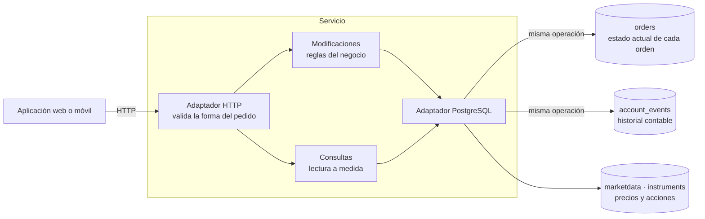
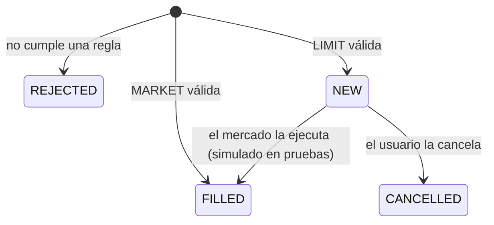
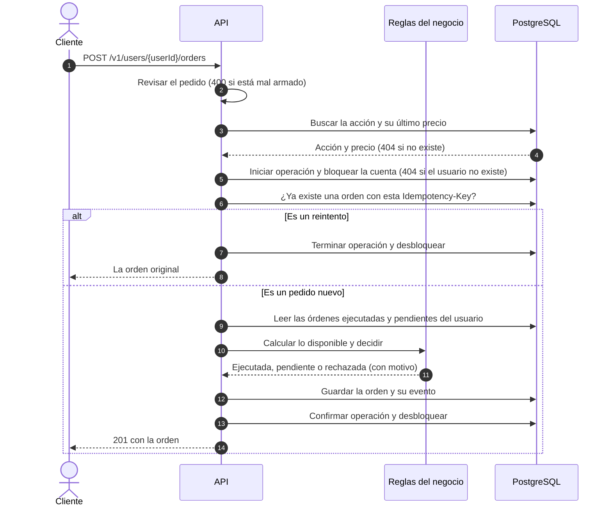

# RFC-001 — API de Portfolio, Búsqueda de Activos y Órdenes

| | |
|---|---|
| **Estado** | PROPUESTO |
| **Autores** | Mayra Urquiza |
| **Última actualización** | 17 nov 2026 |
| **Documentos relacionados** | [Glosario](../glossary.md) · [Enunciado](../../backend-challenge.md) · [Modelo de datos](../../database.sql) |

---

## Objetivo

Construir una **API REST en Node.js**, con precios en pesos, que permita a un usuario:

1. **Ver su portfolio.** El portfolio es todo lo que el usuario tiene: cuánto vale en total, cuántos pesos tiene libres para invertir y, por cada acción que posee, cuántas tiene, cuánto valen hoy y cuánto ganó o perdió en porcentaje.
2. **Buscar acciones** por su código, llamado *ticker* (por ejemplo `PAMP`), o por su nombre (por ejemplo "Pampa").
3. **Comprar y vender acciones.** Cada pedido de compra o venta se llama **orden**. El usuario indica cuántas acciones quiere o cuántos pesos quiere invertir, y elige cómo operar:
   - **MARKET**: compra o vende ya, al precio actual.
   - **LIMIT**: fija el precio que está dispuesto a pagar o cobrar, y la orden queda pendiente hasta que se consiga ese precio.
4. **Cancelar una orden** que todavía está pendiente.

Además, se incluyen dos funciones que el enunciado no pide pero que hacen falta para usar y probar la API:

5. **Ingresar y retirar pesos.** Sin esta función, los usuarios 2, 3 y 4 de los datos de prueba no tienen pesos y no podrían comprar nada.
6. **Consultar órdenes**: el listado de órdenes de un usuario, o una orden puntual por su número, para saber en qué estado quedó y, si se rechazó, por qué.

**Qué problema resuelve:** hoy existe la base de datos, pero no hay nada que aplique reglas sobre ella. Nada impide comprar sin pesos o vender acciones que no se tienen, y no hay forma de ver el portfolio ni de buscar acciones.

## Motivación

En la base de datos que provee el enunciado, todo lo que hace el usuario se guarda como una orden en una única tabla, `orders`: compras, ventas, ingresos y retiros de pesos. Lo que el usuario tiene (sus pesos y sus acciones) no se guarda en ningún lado: se calcula sumando y restando sus órdenes. Esa tabla funciona entonces como el **libro contable** de la cuenta, y si una orden se registra mal, el saldo del usuario queda mal.

De ahí surgen tres necesidades:

1. **Validar antes de registrar.** Ninguna orden puede usar pesos o acciones que el usuario no tiene. Las que no cumplen una regla se guardan igual, marcadas como rechazadas y con el motivo, para que soporte pueda explicar qué pasó.
2. **Decidir lo que el enunciado deja abierto.** Hay reglas que el enunciado no define y que cambian los números que ve el usuario. Por ejemplo, si una orden pendiente deja "apartados" los pesos que va a usar, o contra qué precio se mide la ganancia. Estas decisiones se detallan en [Problemas y desafíos](#problemas-y-desafíos).
3. **Proteger la historia contable.** Una orden cambia de estado a lo largo de su vida: puede quedar pendiente, después cancelarse o ejecutarse. Si el único registro es la fila de la orden, cada cambio pisa el anterior y se pierde qué pasó y cuándo. Por eso se separan dos cosas:
   - **El estado actual de cada orden** (tabla `orders`). Cambia a medida que la orden avanza.
   - **El historial contable** (tabla nueva `account_events`). Solo admite agregar registros: nunca se modifican ni se borran, y la propia base de datos lo impide.

   Así, cualquier saldo se puede reconstruir y explicar paso a paso, y un error al actualizar una orden no puede alterar lo que ya ocurrió.

**A quiénes afecta:**

- **Usuarios:** ven números correctos y no pueden operar con dinero o acciones que no tienen.
- **Soporte:** puede explicar cualquier rechazo o cualquier saldo a partir del historial.
- **Equipo técnico:** el historial deja preparada la base para que, a futuro, otros sistemas (notificaciones, contabilidad) se enteren de lo que pasa en cada cuenta.

## Glosario y actores

### Glosario

Estos son los términos necesarios para leer este documento. Los términos técnicos de la arquitectura se explican en la sección donde aparecen, y la lista completa está en el [glosario del repositorio](../glossary.md).

**Instrumentos y precios**

| Término | Qué significa |
|---|---|
| **Instrumento** | Activo que el usuario puede tener. Hay dos tipos: **acciones** de empresas (65) y **pesos** (1). |
| **Ticker** | Código corto que identifica a un instrumento. Por ejemplo, `PAMP` es Pampa Holding y `ARS` son los pesos. |
| **Pesos** (`ARS`) | El dinero del usuario. Se maneja como un instrumento más: tener 1.000 pesos es como tener 1.000 unidades de `ARS`. |
| **Último precio** | Precio de cierre del día más reciente que hay cargado para una acción. Es el precio al que se compra o vende con una orden MARKET y el que se usa para valuar lo que tiene el usuario. |
| **Retorno diario** | Cuánto subió o bajó el precio de una acción respecto del día anterior, en porcentaje. |

**Órdenes**

| Término | Qué significa |
|---|---|
| **Orden** | Un pedido del usuario: comprar, vender, ingresar pesos o retirar pesos. Todas se guardan, incluso las rechazadas. |
| **Tipo de movimiento** (*side*) | Qué pide la orden: `BUY` (comprar), `SELL` (vender), `CASH_IN` (ingresar pesos) o `CASH_OUT` (retirar pesos). |
| **MARKET** | Orden que se ejecuta en el momento, al último precio. |
| **LIMIT** | Orden con un precio fijado por el usuario. Queda pendiente hasta que se consiga ese precio. |
| **Cantidad** (*size*) | Cuántas acciones se compran o venden, siempre enteras. En las órdenes de pesos, es el monto. |
| **Compra por monto** | En lugar de una cantidad, el usuario indica cuántos pesos quiere invertir. El sistema calcula cuántas acciones enteras alcanzan. Por ejemplo, con 1.000 pesos y un precio de 300 se compran 3 acciones. |
| **Estado** (*status*) | En qué punto está la orden: `NEW` (pendiente), `FILLED` (ejecutada), `REJECTED` (rechazada) o `CANCELLED` (cancelada por el usuario). Solo se puede cancelar una orden pendiente. |
| **Motivo de rechazo** | Por qué se rechazó una orden. Por ejemplo, `INSUFFICIENT_FUNDS` si no alcanzan los pesos. |

**Portfolio**

| Término | Qué significa |
|---|---|
| **Tenencia** (o posición) | Cuántas acciones de una empresa tiene el usuario. Sale de sumar sus compras ejecutadas y restar sus ventas ejecutadas. |
| **Pesos reservados** | Pesos que el usuario ya comprometió en compras LIMIT pendientes. Siguen siendo suyos, pero no los puede usar para otra cosa. Lo mismo pasa con las acciones comprometidas en ventas LIMIT pendientes. |
| **Pesos disponibles para operar** | Los pesos del usuario menos los reservados. Es lo que puede gastar en una nueva compra o retirar. |
| **Costo promedio** | Precio promedio que el usuario pagó por las acciones que todavía tiene. Por ejemplo, si compró 10 a 100 y 10 a 200, su costo promedio es 150. |
| **Ganancia** | Cuánto vale hoy una tenencia menos lo que costó, en pesos. Si es negativa, es una pérdida. |
| **Rendimiento total** | La ganancia expresada en porcentaje sobre lo que costó. Mide solo las acciones que el usuario todavía tiene: lo que ganó o perdió con acciones ya vendidas no se incluye. |
| **Valor total de la cuenta** | Todos los pesos del usuario (incluidos los reservados) más lo que valen hoy todas sus acciones. |
| **Historial contable** | Registro de todo lo que pasó en la cuenta, en orden. Solo se le agregan registros: nunca se modifican ni se borran. |

### Actores

| Actor | Quién es | Qué hace con la API |
|---|---|---|
| **Usuario** | Persona con una cuenta de inversión. Los datos de prueba tienen 4 usuarios, y solo el primero tiene órdenes. | Consulta su portfolio, busca acciones, envía, consulta y cancela órdenes. |
| **Mercado** | Donde se compran y venden las acciones de verdad. El enunciado pide **no** simularlo. | Nada. Se supone que una orden MARKET se ejecuta al instante y que una LIMIT queda pendiente. Solo para pruebas, una ruta especial permite simular que el mercado ejecutó una orden LIMIT. |
| **Proveedor de precios** *(supuesto)* | Sistema externo que carga los precios de cada día. | Nada. La API solo lee los precios que ya están cargados. |
| **Sistema de transferencias** *(supuesto)* | Sistema que mueve pesos entre el banco del usuario y su cuenta. | Avisa a la API cada ingreso o retiro de pesos ya confirmado. En este proyecto, ese aviso se simula a mano con requests de ejemplo. |
| **Soporte** *(supuesto)* | Equipo interno que atiende consultas de usuarios. | Consulta el listado de órdenes de un usuario, con su estado y motivo de rechazo, para explicar qué pasó. |

Los actores marcados como *(supuesto)* no aparecen en el enunciado. Se incluyen para dejar claro qué queda dentro y qué queda fuera del sistema.

## Solución actual

Hoy no hay ninguna aplicación: solo existe la base de datos con datos de prueba, en [database.sql](../../database.sql).

| Tabla | Qué guarda | Qué hay cargado |
|---|---|---|
| `users` | Los usuarios. | 4 usuarios. |
| `instruments` | Las acciones y los pesos. | 65 acciones y los pesos (`ARS`). |
| `marketdata` | El precio de cada acción por día. | Precios de 63 acciones para el 13 y el 14 de julio de 2023. |
| `orders` | Todas las órdenes. | 11 órdenes, todas del usuario 1. |

### Qué tiene hoy el usuario 1

Para entender cómo funciona el cálculo, estas son las 11 órdenes del usuario 1 en el orden en que ocurrieron. Solo las ejecutadas (`FILLED`) cambian lo que tiene, las pendientes (`NEW`) no cambian nada todavía, pero dejan pesos apartados.

| # | Qué pidió | Estado | Pesos | Acciones |
|---|---|---|---|---|
| 1 | Ingresar 1.000.000 pesos | Ejecutada | +1.000.000 | |
| 2 | Comprar 50 PAMP a 930 (MARKET) | Ejecutada | −46.500 | PAMP +50 |
| 3 | Comprar 50 PAMP a 920 (LIMIT) | Cancelada | | |
| 4 | Vender 10 PAMP a 940 (MARKET) | Ejecutada | +9.400 | PAMP −10 |
| 5 | Comprar 50 LOMA a 710 (LIMIT) | **Pendiente** | (aparta 35.500) | |
| 6 | Vender 100 PAMP a 950 (MARKET) | Rechazada | | (tenía solo 40) |
| 7 | Comprar 60 BMA a 1.500 (LIMIT) | **Pendiente** | (aparta 90.000) | |
| 8 | Retirar 100.000 pesos | Ejecutada | −100.000 | |
| 9 | Comprar 20 BMA a 1.540 (LIMIT) | Ejecutada | −30.800 | BMA +20 |
| 10 | Comprar 500 METR a 250 (MARKET) | Ejecutada | −125.000 | METR +500 |
| 11 | Vender 30 BMA a 1.530 (MARKET) | Ejecutada | +45.900 | BMA −30 |

**Resultado:** el usuario 1 tiene 753.000 pesos, de los cuales 125.500 están apartados por las dos compras pendientes. Tiene 40 PAMP, 500 METR y **−10 BMA**: la orden 11 vendió 30 BMA cuando tenía 20, algo que las reglas del enunciado no deberían permitir.

### Problemas y desafíos

**Del negocio**

| # | Problema | Qué se propone | Detalle |
|---|---|---|---|
| 1 | **Datos de prueba inconsistentes.** El usuario 1 tiene −10 BMA por la orden 11. | No se corrige ni se oculta: el portfolio muestra la tenencia negativa con un aviso. Ocultarla haría que la cuenta parezca valer 15.028 pesos más de lo que dicen sus órdenes. | [ADR-0004](../adr/ADR-0004-reglas-de-negocio.md) |
| 2 | **Gastar dos veces la misma plata.** El enunciado no dice si una orden pendiente aparta los pesos. Si no los aparta, el usuario podría dejar varias compras pendientes con el mismo dinero. | Las órdenes pendientes apartan pesos (compras) o acciones (ventas) hasta que se ejecutan o se cancelan. Para el usuario 1, sus pesos disponibles pasan de 753.000 a 627.500. | [ADR-0004](../adr/ADR-0004-reglas-de-negocio.md) |
| 3 | **"Rendimiento" sin definir.** El enunciado pide el rendimiento de cada acción, pero no dice contra qué precio de compra medirlo. | Se mide contra el costo promedio de las acciones que el usuario todavía tiene. Si la tenencia es negativa, no se calcula. | [ADR-0004](../adr/ADR-0004-reglas-de-negocio.md) |
| 4 | **Acciones sin precio.** `PGR` e `IRCP` no tienen precios cargados. | No se pueden comprar ni vender al precio actual (MARKET), y en el portfolio aparecen con un aviso. Como no suman al valor total, el portfolio avisa además que ese total está incompleto. | |
| 5 | **Monto que no alcanza.** Si el usuario quiere invertir menos de lo que vale una acción, la cantidad da 0. | Se rechaza la orden indicando ese motivo. | |
| 6 | **Precios viejos.** Los últimos precios cargados son de julio de 2023. | Se usan igual: el enunciado los define como el último precio. Controlar la antigüedad de los precios queda fuera de alcance. | |

**Técnicos**

| # | Problema | Qué se propone | Detalle |
|---|---|---|---|
| 7 | **Pedidos simultáneos.** Si llegan dos compras del mismo usuario al mismo tiempo, las dos podrían ver los mismos pesos disponibles y aprobarse, aunque juntas superen lo que tiene. | Los pedidos que modifican una cuenta se atienden de a uno por usuario. Los pedidos de usuarios distintos no se esperan entre sí. | [ADR-0003](../adr/ADR-0003-persistencia-consistencia-y-cantidades.md) |
| 8 | **Pedidos repetidos.** Si la aplicación no recibe respuesta (por ejemplo, por un corte de conexión) y reintenta, la orden se registraría dos veces. | La aplicación puede mandar una clave única por pedido. Si llega dos veces la misma clave, se devuelve la orden ya creada en lugar de crear otra. | [ADR-0005](../adr/ADR-0005-contrato-de-la-api.md) |
| 9 | **Errores de redondeo.** Los números con decimales de JavaScript generan errores al sumar montos (por ejemplo, 0,1 + 0,2 da 0,30000000000000004). | Todos los montos se calculan con una librería de aritmética decimal y viajan como texto en la API. | [ADR-0005](../adr/ADR-0005-contrato-de-la-api.md) |
| 10 | **Base de datos sin controles.** No impide valores inválidos (por ejemplo, un estado inexistente), no tiene índices para buscar rápido y no tiene dónde guardar el motivo de un rechazo. | Se agregan controles, índices y la columna del motivo de rechazo, sin romper los datos existentes. | [Cambios al modelo de datos](#cambios-al-modelo-de-datos) |
| 11 | **Los montos de pesos no admiten centavos.** La columna de cantidad solo guarda números enteros. | Se amplía para admitir 2 decimales. La base sigue exigiendo que las acciones sean enteras. | [ADR-0003](../adr/ADR-0003-persistencia-consistencia-y-cantidades.md) |
| 12 | **El enunciado y la base no coinciden en algunos nombres.** Por ejemplo, el enunciado habla de `datetime` en los precios, pero la columna se llama `date`. | La traducción entre nombres se hace en un solo lugar del código. | [ADR-0001](../adr/ADR-0001-stack-http-validacion-y-acceso-a-datos.md) |

## Solución propuesta

### Arquitectura propuesta

Un único servicio, escrito en Node.js, que recibe pedidos por HTTP, aplica las reglas del negocio y guarda todo en una base de datos PostgreSQL.

#### Patrones de arquitectura

- **Arquitectura hexagonal.** Las reglas del negocio quedan aisladas de HTTP y de la base de datos. **Por qué:** las reglas son lo más delicado del sistema (manejan dinero), y así se pueden probar sin levantar una base de datos. Además, se puede cambiar cómo se guardan los datos sin tocarlas, que es justamente lo que requiere la [Evolución prevista](#evolución-prevista) ([ADR-0002](../adr/ADR-0002-arquitectura-y-patrones-de-dominio.md)).
- **CQRS lógico.** Los pedidos que modifican la cuenta (enviar o cancelar órdenes, transferir pesos) y los que solo consultan (portfolio, búsqueda, órdenes) siguen caminos separados en el código, pero sobre la misma base de datos. **Por qué:** las modificaciones necesitan validar reglas y bloquear la cuenta, mientras que las consultas solo necesitan leer rápido con una consulta a medida. Al compartir la base, apenas se ejecuta una orden el portfolio ya la refleja ([ADR-0002](../adr/ADR-0002-arquitectura-y-patrones-de-dominio.md)).



#### Cómo se procesa un pedido que modifica la cuenta

Tomando como ejemplo el envío de una orden:

1. **Revisar el pedido.** Si está mal armado (por ejemplo, falta la cantidad), se responde con un error y no se guarda nada.
2. **Buscar el precio** de la acción.
3. **Bloquear la cuenta del usuario.** Mientras dura el pedido, cualquier otro pedido que modifique la misma cuenta espera su turno. Los pedidos de otros usuarios siguen sin esperar.
4. **Revisar si es un reintento.** Si el pedido trae una clave que ya se usó, se devuelve la orden que se creó la primera vez. Se revisa con la cuenta bloqueada para que dos reintentos simultáneos no creen dos órdenes.
5. **Calcular lo que el usuario tiene disponible:** pesos y acciones, descontando lo apartado por órdenes pendientes.
6. **Decidir.** Las reglas del negocio indican si la orden se ejecuta, queda pendiente o se rechaza, y por qué.
7. **Guardar** la orden y su registro en el historial contable, **juntos**: o se guardan los dos, o ninguno.
8. **Desbloquear la cuenta** y responder.

El detalle de cada paso está en [Flujo de trabajo propuesto](#flujo-de-trabajo-propuesto).

#### Estado actual e historial contable

Como se explicó en la [Motivación](#motivación), cada cambio en una cuenta se guarda en dos tablas, en la misma operación:

| Tabla | Qué guarda | ¿Se puede modificar? | Para qué sirve |
|---|---|---|---|
| `orders` | Cómo está **hoy** cada orden. | Sí, pero solo con cambios de estado válidos (por ejemplo, de pendiente a cancelada). | Calcular los pesos y las acciones del usuario, como pide el enunciado. |
| `account_events` | **Todo lo que pasó** en la cuenta, en orden: "se ejecutó la orden 12", "se canceló la orden 5". | No. La base de datos rechaza cualquier intento de modificar o borrar un registro. | Auditar y explicar cualquier saldo, y en el futuro avisar a otros sistemas ([Evolución prevista](#evolución-prevista)). |

Si las dos tablas dejaran de coincidir, sería señal de un error. Por eso se controla de forma automática que, al reconstruir la cuenta desde el historial, se obtenga lo mismo que dice `orders` ([ADR-0003](../adr/ADR-0003-persistencia-consistencia-y-cantidades.md)).

#### Principios del diseño

- **La cuenta es la unidad de control.** La regla "no gastar más de lo que se tiene" abarca todas las órdenes de un usuario, así que todo cambio se valida y se guarda a nivel de cuenta ([ADR-0002](../adr/ADR-0002-arquitectura-y-patrones-de-dominio.md)).
- **Un único cálculo de lo disponible.** Lo que el portfolio muestra como disponible es exactamente lo que se usa para aprobar o rechazar una orden. No hay dos cálculos que puedan dar distinto.
- **Rechazar no es lo mismo que fallar.** Una orden bien armada que no cumple una regla (por ejemplo, sin fondos) se guarda como rechazada y se responde con éxito, indicando el motivo. Un pedido mal armado se responde con error y no se guarda ([ADR-0005](../adr/ADR-0005-contrato-de-la-api.md)).
- **Los montos nunca se redondean por accidente.** Todo cálculo con dinero usa aritmética decimal exacta.

#### Tecnologías elegidas

| Pieza | Elección | Por qué | Detalle |
|---|---|---|---|
| Lenguaje | Node.js + TypeScript | Node.js lo pide el enunciado. TypeScript detecta errores de tipos antes de ejecutar. | |
| Servidor HTTP y validación de pedidos | Fastify + TypeBox | La misma definición de cada pedido sirve para validarlo y para generar la documentación de la API. | [ADR-0001](../adr/ADR-0001-stack-http-validacion-y-acceso-a-datos.md) |
| Base de datos | PostgreSQL | Es la base que provee el enunciado. | |
| Acceso a la base | Kysely | Permite escribir consultas SQL con control de tipos, sin la complejidad de un ORM. | [ADR-0001](../adr/ADR-0001-stack-http-validacion-y-acceso-a-datos.md) |
| Cálculos con dinero | decimal.js | Evita los errores de redondeo de los números de JavaScript. | |
| Tests | Jest | Las reglas del negocio se prueban sin base de datos; el acceso a datos, contra un PostgreSQL real; y el envío de órdenes, de punta a punta. | |
| Documentación de la API | OpenAPI + colección de requests de ejemplo | La documentación se genera desde el código, así que no se desactualiza. La colección permite probar la API sin escribir pedidos a mano. | |

Los patrones de diseño usados en las reglas del negocio (máquina de estados de las órdenes, estrategias por tipo de orden, etc.) se describen en [Componentes](#componentes) y en [ADR-0002](../adr/ADR-0002-arquitectura-y-patrones-de-dominio.md).

### Alcance y fuera de alcance

**Qué incluye este proyecto**

- **Las seis funciones del [Objetivo](#objetivo):** portfolio, búsqueda, envío y cancelación de órdenes, transferencias de pesos y consulta de órdenes.
- **Protección contra pedidos repetidos** en el envío de órdenes y en las transferencias.
- **Simulación de la ejecución de una orden LIMIT, solo para pruebas.** Una ruta separada marca una orden pendiente como ejecutada, al precio límite y por la cantidad completa. Sin ella, ninguna orden LIMIT podría llegar a ejecutarse y no se podría probar qué pasa en ese caso: que los pesos o acciones apartados se descuenten de verdad, que se actualicen el costo promedio y el portfolio, y que se registre en el historial. La ruta solo existe si se activa una variable de entorno, que viene apagada por defecto.
- **El historial contable** (`account_events`). Incluye cargar en él las 11 órdenes que ya existen en los datos de prueba, para que esté completo desde el primer día.
- **Los cambios a la base de datos** descritos en [Cambios al modelo de datos](#cambios-al-modelo-de-datos). Ninguno rompe los datos existentes.
- **Tests:**
  - Reglas del negocio, sin base de datos.
  - Acceso a datos, contra un PostgreSQL real.
  - Envío de órdenes de punta a punta, que es el test funcional que pide el enunciado.
  - Que el historial contable y `orders` coincidan, y que dos órdenes simultáneas no puedan gastar los mismos pesos.
- **Integración continua (CI)** con GitHub Actions: en cada cambio que se sube al repositorio corren todos los tests y una verificación automática de que las reglas del negocio no dependan de HTTP ni de la base de datos.
- **Documentación de la API** (OpenAPI) y una **colección de requests de ejemplo** para probarla.

**Qué queda afuera**

| Qué | Por qué | Qué se hace en su lugar |
|---|---|---|
| **Inicio de sesión y permisos** | El enunciado indica que no hace falta. | El usuario se indica en la ruta (`/v1/users/{userId}/...`). En producción saldría de la sesión, y la ruta ya permite verificar que el usuario solo acceda a lo suyo. |
| **Motor de ejecución del mercado:** ejecutar órdenes LIMIT automáticamente cuando el precio alcanza el límite, ejecuciones parciales o a un precio mejor | El enunciado indica que no hace falta simular el mercado. Además, exigiría que la API cargue precios, que hoy vienen de otro sistema. | La ejecución se simula a mano con la ruta de pruebas. |
| **Conexión real con bancos** | Es otro sistema. | La API registra ingresos y retiros de pesos que se suponen ya confirmados. |
| **Carga de precios** | Es otro sistema. | La API solo lee los precios que ya están en la base. Los tests que necesitan precios específicos los cargan directamente en la base. |
| **Control de antigüedad de los precios** | El enunciado define el último precio cargado como el precio actual. | Se usa ese precio, aunque sea de 2023. |
| **Comisiones, impuestos, dividendos y otras monedas** | El enunciado no los menciona, y modelarlos requiere separar los movimientos de dinero de las órdenes ([ADR-0003](../adr/ADR-0003-persistencia-consistencia-y-cantidades.md)). | Nada. Quedan como posible evolución. |
| **Avisar a otros sistemas** de lo que pasa en las cuentas | Ningún otro sistema lo necesita hoy. | El historial contable ya guarda todo lo necesario para hacerlo después ([Evolución prevista](#evolución-prevista)). |
| **Tabla de saldos precalculados** | Con el volumen actual, calcular los saldos desde las órdenes alcanza. | Se calculan en cada pedido. Queda como evolución, con un criterio claro de cuándo hacerla ([Evolución prevista](#evolución-prevista)). |

### Especificaciones funcionales y técnicas

#### Portfolio

Solo cuentan las órdenes ejecutadas (`FILLED`), salvo para las reservas, que salen de las pendientes (`NEW`).

| Dato | Cómo se calcula |
|---|---|
| Tenencia de una acción | Acciones compradas − acciones vendidas |
| Pesos | Ingresos − retiros − lo pagado en compras + lo cobrado en ventas |
| Pesos reservados | Σ cantidad × precio límite de las compras LIMIT pendientes |
| Acciones reservadas | Σ cantidad de las ventas LIMIT pendientes de esa acción |
| **Pesos disponibles** | Pesos − pesos reservados |
| Acciones disponibles | Tenencia − acciones reservadas |
| Costo promedio | Se recorren las órdenes por fecha (y por número si coinciden). Cada compra actualiza el promedio: `(tenencia × promedio + cantidad × precio) / (tenencia + cantidad)`. Una venta baja la tenencia sin cambiar el promedio. Si la tenencia llega a 0, el promedio se reinicia. |
| Valor de mercado | Tenencia × último precio |
| Ganancia | Valor de mercado − tenencia × costo promedio |
| Rendimiento total (%) | Ganancia / (tenencia × costo promedio) × 100 |
| Retorno diario (%) | (último precio − precio de cierre anterior) / precio de cierre anterior × 100 |
| **Valor total** | Pesos (incluidos los reservados) + Σ valor de mercado |

- Las acciones con tenencia 0 no se muestran.
- **Avisos.** Cada acción trae una lista `warnings`, vacía si no hay problemas. Si alguna acción tiene un aviso, el portfolio también lo indica a nivel general.

  | Aviso | Cuándo | Qué pasa |
  |---|---|---|
  | `NEGATIVE_QUANTITY` | La tenencia es negativa (BMA en los datos de prueba). | Se muestra igual y suma al valor total. Costo promedio, ganancia y rendimiento quedan vacíos (`null`). |
  | `NO_MARKET_PRICE` | La acción no tiene precios. | Precio, valor de mercado, ganancia y rendimiento quedan vacíos. No suma al valor total, que se marca como incompleto. |

**Ejemplo, usuario 1 (precios del 14/07/2023):**

| Acción | Tenencia | Costo prom. | Último precio | Valor de mercado | Ganancia | Rendimiento |
|---|---|---|---|---|---|---|
| PAMP | 40 | 930,00 | 925,85 | 37.034,00 | −166,00 | −0,45 % |
| METR | 500 | 250,00 | 229,50 | 114.750,00 | −10.250,00 | −8,20 % |
| BMA | −10 | — | 1.502,80 | −15.028,00 | — | — |

Pesos: 753.000 · Reservados: 125.500 · **Disponibles: 627.500** · **Valor total: 889.756**

#### Envío de órdenes

**1. Pedido mal armado → error `400`, no se guarda.**
- `side`: `BUY` o `SELL`. `type`: `MARKET` o `LIMIT`.
- Exactamente uno de `size` (entero mayor que 0) o `amount` (mayor que 0, hasta 2 decimales).
- `LIMIT` exige `price` (mayor que 0, hasta 2 decimales, como máximo 99.999.999,99). `MARKET` no acepta `price`.
- No se puede operar `ARS` (`INSTRUMENT_NOT_TRADABLE`).
- Si el usuario o la acción no existen → `404`.

**2. Precio.** `MARKET` usa el último precio. `LIMIT` usa el informado, aunque la acción no tenga precios cargados.

**3. Cantidad.** Si se envió `amount`, la cantidad es la mayor cantidad de acciones enteras que alcanza: `amount / precio`, sin decimales.

**4. Reglas del negocio → se guarda como `REJECTED` con su motivo y se responde `201`.**

| Motivo | Cuándo |
|---|---|
| `NO_MARKET_PRICE` | Orden `MARKET` sobre una acción sin precios. Se guarda sin precio. |
| `ZERO_QUANTITY` | El `amount` no alcanza para una acción. Se guarda con cantidad 0. |
| `INSUFFICIENT_FUNDS` | Compra: cantidad × precio supera los pesos disponibles. |
| `INSUFFICIENT_HOLDINGS` | Venta: la cantidad supera las acciones disponibles. |

**5. Si pasa todas las reglas:** `MARKET` queda `FILLED` y `LIMIT` queda `NEW`.

**6. Pedidos repetidos.** El pedido puede traer el encabezado `Idempotency-Key` con una clave única. Si la clave ya se usó para ese usuario, se devuelve la orden original sin crear otra. Si se repite la clave con un pedido distinto, se responde `409 IDEMPOTENCY_KEY_REUSED`.

**Cancelación.** Solo una orden `NEW` del mismo usuario de la ruta. Si no existe o es de otro usuario → `404`. Si no está pendiente → `409`. Responde `200` con la orden actualizada.

**Simulación de ejecución** (solo con la variable `MARKET_SIMULATION_ENABLED`). Pasa una orden `NEW` a `FILLED`, al precio límite y por la cantidad completa. No vuelve a validar fondos, porque ya estaban reservados. Si no está pendiente → `409`. Si la variable está apagada, la ruta no existe.



#### Transferencias

Tienen su propia ruta para crearlas, separada de la de órdenes, porque las informa el sistema de transferencias y no el usuario: el día que haya permisos, el usuario no debe poder acreditarse pesos. Para consultarlas no hay ruta propia: aparecen en el listado de órdenes del usuario, porque se guardan como órdenes.

- `type`: `CASH_IN` o `CASH_OUT`. `amount`: mayor que 0, hasta 2 decimales. Si no → `400`.
- Se guardan como una orden sobre `ARS`: `side = type`, `size = amount`, `price = 1`, `type = MARKET`.
- `CASH_IN` queda siempre `FILLED`.
- `CASH_OUT` queda `FILLED` si `amount` no supera los pesos disponibles; si no, queda `REJECTED` con `INSUFFICIENT_FUNDS`.
- La respuesta tiene la misma forma que la de una orden, y admiten `Idempotency-Key` igual que las órdenes.

#### Búsqueda

- Busca el texto `q` (mínimo 1 carácter) dentro del ticker o del nombre, sin distinguir mayúsculas ni tildes: "rio" encuentra "Molinos Río de la Plata". Los caracteres especiales de búsqueda (`%`, `_`) se tratan como texto común.
- Orden: primero el ticker exacto, después los tickers que empiezan con `q` y después el resto, por ticker.
- No incluye `ARS`. Cada resultado trae el último precio y el retorno diario, si existen.
- Paginación con `limit` (20 por defecto, máximo 100) y `offset`. La respuesta incluye el `total` de resultados.

#### Historial contable (`account_events`)

Cada pedido que modifica una cuenta, aceptado o rechazado, agrega **un** registro, en la misma operación que el cambio en `orders`. La base impide modificar o borrar registros: un trigger lo bloquea y el usuario de base de datos de la aplicación solo tiene permiso para leer e insertar.

| Campo | Para qué |
|---|---|
| `id` | Orden global de los registros. |
| `event_id` | Identificador único, para que un sistema que lo reciba no lo procese dos veces. |
| `account_id` + `sequence` | A qué cuenta pertenece y en qué posición está dentro de su historial. No puede haber dos registros con la misma posición en la misma cuenta. |
| `event_type` + `event_version` | Qué pasó y con qué formato está guardado el detalle. |
| `order_id` | La orden afectada. |
| `payload` | El detalle de lo que pasó. |
| `metadata` | De dónde vino el pedido, para rastrearlo. |
| `occurred_at` | Cuándo pasó. |

| Evento | Cuándo |
|---|---|
| `OrderAccepted` | Una orden LIMIT queda pendiente. |
| `OrderFilled` | Una orden se ejecuta: una MARKET al enviarse o una LIMIT por la simulación. |
| `OrderRejected` | Una orden o un retiro se rechaza. Incluye el motivo. |
| `OrderCancelled` | Se cancela una orden pendiente. |
| `CashTransferredIn` / `CashTransferredOut` | Se ejecuta un ingreso o un retiro de pesos. |
| `LegacyOrderImported` | Solo para cargar las 11 órdenes de prueba que ya existían. |

El contenido de cada evento y cómo se calcula `sequence` están en [ADR-0003](../adr/ADR-0003-persistencia-consistencia-y-cantidades.md).

#### Cambios al modelo de datos

Ninguno renombra ni borra columnas, y los datos existentes siguen siendo válidos.

| Cambio | Por qué |
|---|---|
| Tabla nueva `account_events` | El historial contable. |
| `orders.size` pasa de entero a decimal con 2 decimales, con un control que exige enteros salvo en ingresos y retiros | Permitir centavos en las transferencias ([ADR-0003](../adr/ADR-0003-persistencia-consistencia-y-cantidades.md)). |
| Columna nueva `orders.rejectReason`, con un control de valores permitidos | Guardar el motivo de cada rechazo. |
| Columnas nuevas `orders.idempotencyKey` y `orders.requestHash`, únicas por usuario | Detectar pedidos repetidos y comparar si el contenido es el mismo. |
| Controles de valores permitidos en `side`, `type` y `status` | Impedir valores inválidos. |
| Control de cantidad y precio mayores que 0, salvo en órdenes rechazadas | Una orden rechazada puede no tener precio o tener cantidad 0. |
| Índice `orders (userId, status, instrumentId)` | Calcular rápido la cuenta y el portfolio. |
| Índice único `marketdata (instrumentId, date)` | Encontrar rápido el último precio e impedir dos precios para el mismo día. |
| Índice único `instruments (ticker)` | Un ticker identifica una sola acción. |
| Extensión `unaccent` de PostgreSQL | Que la búsqueda ignore tildes. Con 66 instrumentos no hace falta un índice para esta búsqueda. |

Las fechas de `orders.datetime` se guardan en UTC.

#### Flujo de trabajo propuesto

Así se procesa el envío de una orden. La cancelación, las transferencias y la simulación de ejecución siguen el mismo flujo desde el paso 5: bloquear la cuenta, decidir y guardar la orden y su evento juntos.



Si algo falla entre el bloqueo y la confirmación, se deshace todo: no queda una orden sin su evento ni un evento sin su orden.

### Componentes

| Componente | Capa | Responsabilidad |
|---|---|---|
| **Decider de Cuenta** | Dominio | Recibe el estado de la cuenta y un pedido, y decide qué pasa: ejecutar, dejar pendiente, rechazar o cancelar. No lee ni escribe en la base. |
| **Estado de la cuenta** | Dominio | Único cálculo de pesos, tenencias y reservas a partir de las órdenes. Lo usan tanto el decider como el portfolio, para que el disponible validado y el mostrado sean el mismo. |
| **Servicio de validaciones financieras** | Dominio | Calcula pesos y acciones disponibles y verifica si alcanzan para una orden. |
| **Máquina de estados de órdenes** | Dominio | Única forma de cambiar el estado de una orden. Rechaza las transiciones inválidas (por ejemplo, cancelar una orden ejecutada). |
| **Estrategias por tipo y por side** | Dominio | Lo que cambia según la orden: qué precio usa y en qué estado queda (`MARKET` / `LIMIT`), y qué valida, qué reserva y cómo afecta los saldos (`BUY` / `SELL` / `CASH_IN` / `CASH_OUT`). |
| **Proyección del portfolio** | Dominio | Toma el estado de la cuenta y los precios, y calcula costo promedio, valor de mercado, ganancia, rendimientos y avisos. |
| **Casos de uso** | Aplicación | Uno por funcionalidad. Coordinan los pasos (buscar precio, bloquear, decidir, guardar) sin conocer reglas ni SQL. |
| **Adaptador HTTP** | Infraestructura | Rutas, validación de la forma de los pedidos, traducción de errores a códigos HTTP, OpenAPI y `/health`. |
| **Repositorio de Cuenta** | Infraestructura | Bloquea la cuenta, carga sus órdenes y guarda la orden y su evento juntos. |
| **Consultas de lectura** | Infraestructura | Consultas a medida para el portfolio, la búsqueda y las órdenes. |
| **Proveedor de precios** | Infraestructura | Lee el último precio de cada acción. |

Por qué se eligió cada patrón y cómo se verifica que se respete: [ADR-0002](../adr/ADR-0002-arquitectura-y-patrones-de-dominio.md). Ubicación en el código: [README](../../README.md#estructura-de-carpetas).

### Interfaces

Convenciones comunes a todas las respuestas ([ADR-0005](../adr/ADR-0005-contrato-de-la-api.md)):

- **Montos y cantidades viajan como texto** (`"925.85"`, `"40"`), para que el cliente no pierda precisión al leerlos.
- **Pedidos repetidos:** el envío de órdenes y las transferencias aceptan el encabezado `Idempotency-Key`. Un reintento con la misma clave recibe la misma respuesta que la primera vez.
- **Errores:** todos tienen la misma forma, con un `code` fijo que el cliente puede usar para decidir qué hacer.

```json
{ "code": "VALIDATION_ERROR", "message": "Se debe enviar size o amount, no ambos", "details": [{ "field": "amount" }] }
```

| `code` | HTTP |
|---|---|
| `VALIDATION_ERROR`, `INSTRUMENT_NOT_TRADABLE` | `400` |
| `USER_NOT_FOUND`, `INSTRUMENT_NOT_FOUND`, `ORDER_NOT_FOUND` | `404` |
| `ORDER_NOT_PENDING`, `IDEMPOTENCY_KEY_REUSED` | `409` |

**Envío de orden**

```json
// Por cantidad, LIMIT
{ "instrumentId": 47, "side": "BUY", "type": "LIMIT", "size": 10, "price": 900 }

// Por monto, MARKET: 50000 / 925.85 = 54 acciones
{ "instrumentId": 47, "side": "BUY", "type": "MARKET", "amount": 50000 }
```

Respuesta `201` al segundo pedido. Las transferencias, el detalle, el listado, la cancelación y la simulación devuelven órdenes con esta misma forma.

```json
{
  "id": 12, "userId": 1, "instrumentId": 47,
  "side": "BUY", "type": "MARKET", "size": "54", "price": "925.85",
  "status": "FILLED", "rejectReason": null,
  "datetime": "2026-11-17T14:02:11.000Z"
}
```

**Transferencia**

```json
{ "type": "CASH_IN", "amount": 200000.50 }
```

**Portfolio** (usuario 1; se omite METR por brevedad). El `warnings` general reúne los avisos de las acciones; si incluye `NO_MARKET_PRICE`, el valor total está incompleto.

```json
{
  "userId": 1, "accountNumber": "10001",
  "totalValue": "889756.00",
  "cash": { "total": "753000.00", "reserved": "125500.00", "available": "627500.00" },
  "warnings": ["NEGATIVE_QUANTITY"],
  "positions": [
    {
      "instrumentId": 47, "ticker": "PAMP", "name": "Pampa Holding S.A.",
      "quantity": "40", "avgCostPrice": "930.00", "lastPrice": "925.85",
      "marketValue": "37034.00", "gain": "-166.00", "returnPct": "-0.45",
      "dailyReturnPct": "0.44", "warnings": []
    },
    {
      "instrumentId": 31, "ticker": "BMA", "name": "Banco Macro S.A.",
      "quantity": "-10", "avgCostPrice": null, "lastPrice": "1502.80",
      "marketValue": "-15028.00", "gain": null, "returnPct": null,
      "dailyReturnPct": "-1.15", "warnings": ["NEGATIVE_QUANTITY"]
    }
  ]
}
```

**Búsqueda**

```json
{
  "items": [
    { "id": 31, "ticker": "BMA", "name": "Banco Macro S.A.", "type": "ACCIONES", "lastPrice": "1502.80", "dailyReturnPct": "-1.15" }
  ],
  "total": 1, "limit": 20, "offset": 0
}
```

### Rutas

Todas las rutas llevan el prefijo `/v1`, salvo `/health`.

| Método | Ruta | Qué hace | Respuestas |
|---|---|---|---|
| `GET` | `/v1/users/{userId}/portfolio` | Portfolio del usuario. | `200`, `404` |
| `GET` | `/v1/instruments?q=&limit=&offset=` | Busca acciones por ticker o nombre. | `200`, `400` |
| `POST` | `/v1/users/{userId}/orders` | Envía una orden. Un rechazo por reglas del negocio también responde `201`, con `status: REJECTED`. | `201`, `400`, `404`, `409` |
| `GET` | `/v1/users/{userId}/orders?limit=&offset=` | Lista las órdenes del usuario, de la más nueva a la más vieja. Incluye las transferencias. | `200`, `404` |
| `GET` | `/v1/users/{userId}/orders/{orderId}` | Detalle de una orden del usuario. | `200`, `404` |
| `POST` | `/v1/users/{userId}/orders/{orderId}/cancel` | Cancela una orden pendiente. | `200`, `404`, `409` |
| `POST` | `/v1/users/{userId}/transfers` | Registra un ingreso o un retiro de pesos. Un retiro sin fondos responde `201`, con `status: REJECTED`. | `201`, `400`, `404`, `409` |
| `POST` | `/v1/simulation/orders/{orderId}/fill` | Ejecuta una orden LIMIT pendiente. Solo existe con `MARKET_SIMULATION_ENABLED`. | `200`, `404`, `409` |
| `GET` | `/health` | Indica si el servicio y la base de datos están funcionando. | `200`, `503` |

### Métricas

| Qué se mide | Para qué |
|---|---|
| **Del negocio** | |
| Órdenes por estado, tipo y side | Cuánto se opera y cómo. |
| Rechazos por motivo | Detectar fricción. Por ejemplo, muchos `INSUFFICIENT_FUNDS` sugieren que la aplicación muestra mal los pesos disponibles. |
| Cancelaciones de órdenes LIMIT | Saber si los usuarios eligen precios límite poco realistas. |
| Monto operado en pesos | Nivel de actividad. |
| **Técnicas** | |
| Tiempo de respuesta (p95) por ruta | Compararlo con los objetivos de abajo. |
| Errores `4xx` y `5xx` por ruta | Distinguir pedidos mal armados de fallas del servicio. |
| Tiempo de espera por cuenta bloqueada | Detectar pedidos que se traban esperando su turno. |
| Reintentos detectados con `Idempotency-Key` | Saber cuántos pedidos repetidos se evitaron. Si son muchos, hay problemas de conexión con los clientes. |
| **De integridad de datos** | |
| Diferencias entre `orders` y el historial contable | Debe ser siempre 0. Cualquier diferencia es un error grave. |
| Tenencias negativas y acciones sin precio | Detectar datos inconsistentes o precios que no llegaron. |

**Objetivos de tiempo de respuesta** (p95, medido en el servidor, a validar con producto):

| Rutas | p95 | Por qué |
|---|---|---|
| Envío, cancelación y transferencias | ≤ 200 ms | Bloquean la cuenta: si son lentas, los demás pedidos del usuario esperan. Además, leen todas las órdenes del usuario, así que se vuelven más lentas a medida que el historial crece. |
| Portfolio | ≤ 300 ms | También lee todo el historial del usuario y además busca precios. |
| Búsqueda y consulta de órdenes | ≤ 150 ms | Consultas simples con índices. |

Si el envío o el portfolio superan su objetivo, es la señal para agregar la tabla de saldos precalculados ([Evolución prevista](#evolución-prevista)).

**Qué se implementa en este proyecto:** logs en formato JSON con usuario, orden, estado, motivo de rechazo y duración de cada pedido. Alcanzan para calcular todas las métricas anteriores. Exponerlas en un formato listo para un sistema de monitoreo (por ejemplo, Prometheus) queda como evolución.

### Plan de rollout

No hay usuarios reales ni otros sistemas que dependan de esta API, así que se despliega de una vez. La construcción se divide en cuatro pasos, y cada uno deja la aplicación funcionando y con sus tests en verde.

| Paso | Qué se construye | Listo cuando |
|---|---|---|
| **1. Base** | Estructura del proyecto, PostgreSQL en Docker con los datos de prueba, cambios al modelo de datos, carga de las 11 órdenes existentes en el historial, manejo de errores, `/health` y CI. | La base levanta desde cero con un solo comando, el historial tiene 11 registros y CI corre en cada cambio. |
| **2. Consultas** | Búsqueda, listado y detalle de órdenes, y portfolio. | El portfolio del usuario 1 da exactamente los números del [ejemplo](#portfolio). |
| **3. Modificaciones** | Reglas del negocio completas, envío y cancelación de órdenes, transferencias, idempotencia y simulación de ejecución. | Cada pedido deja exactamente un registro en el historial. De dos órdenes simultáneas que juntas superan los fondos, una se rechaza. Un reintento no duplica la orden. `orders` coincide con el historial. |
| **4. Entrega** | Documentación OpenAPI, colección de requests de ejemplo y README con instrucciones y supuestos. | Alguien sin contexto puede levantar la API y probar todas las rutas siguiendo el README. |

**Dos detalles de la base de datos para tener en cuenta desde el paso 1:**

- **Dos usuarios de base de datos.** La aplicación usa uno que solo puede leer e insertar en el historial. Las migraciones usan otro, con permisos para modificar el esquema.
- **Limpieza entre tests.** El historial no se puede vaciar (la base lo impide, a propósito), así que los tests de integración recrean la base desde cero en lugar de borrar los datos.

### Retrocompatibilidad

| Qué | Cómo se mantiene compatible |
|---|---|
| **Base de datos** | Solo se agregan cosas (una tabla, columnas opcionales, índices, controles y una extensión) y se amplía `orders.size` para admitir decimales, sin perder ningún valor existente. Las consultas que ya funcionaban siguen funcionando, y las 11 órdenes existentes cumplen todos los controles nuevos. |
| **Datos existentes** | No se modifica ninguna orden, ni siquiera la venta inconsistente de BMA. Se cargan en el historial tal como están, sin inventar pasos intermedios. |
| **Historial contable** | Cada registro guarda la versión de su formato (`event_version`). Si el formato cambia, los registros viejos se siguen pudiendo leer. |
| **API** | Es nueva y nace con `/v1`. Agregar campos o rutas no cambia la versión, cambiar o quitar algo existente requiere `/v2` ([ADR-0005](../adr/ADR-0005-contrato-de-la-api.md)). |

## Evolución prevista

El MVP ya deja resuelto lo que haría costosa una migración tardía: el historial contable completo desde el primer día, una secuencia por cuenta y reglas del negocio que no dependen de cómo se guardan los datos. Por eso cada evolución es independiente, se hace solo cuando aparece su disparador y tendrá su propio RFC o ADR.

| Evolución | Qué cambia | Cuándo hacerla | Qué se toca |
|---|---|---|---|
| **Tabla de saldos precalculados** | Una tabla con los pesos, las tenencias, las reservas y el costo promedio de cada cuenta, actualizada en la misma operación que `orders` y el historial. Las modificaciones y el portfolio la leen en lugar de recorrer todas las órdenes. | El envío de órdenes o el portfolio superan su [objetivo de tiempo de respuesta](#métricas). | El repositorio de Cuenta y la consulta del portfolio. Las reglas del negocio no cambian. |
| **Publicar el historial a otros sistemas** (outbox transaccional) | Un proceso lee los registros nuevos del historial y los publica en un sistema de mensajería. Los sistemas que los reciben usan `event_id` para no procesar dos veces el mismo registro. | Otro sistema necesita enterarse de lo que pasa en las cuentas (notificaciones, riesgo, contabilidad). | Solo se agrega infraestructura nueva. |
| **Event sourcing** | El estado de la cuenta se obtiene del historial contable en lugar de `orders`, que pasa a ser una vista derivada. | Se necesitan consultas en el tiempo ("¿qué tenía la cuenta el día X?") o reglas que dependen del orden de los hechos y no solo del saldo. **Condición previa:** `orders` y el historial coinciden de forma sostenida ([Métricas](#métricas)). | Solo el repositorio de Cuenta. Las reglas del negocio y los casos de uso no cambian. |

- **Tabla o vista materializada.** Se prefiere una tabla actualizada en la misma operación, porque siempre está al día. Una vista materializada de PostgreSQL se recalcula entera y cada cierto tiempo, así que el disponible podría quedar desactualizado y dejar de coincidir con el que se usa para validar.
- **Riesgo conocido de la publicación:** dos operaciones que terminan en distinto orden del que empezaron pueden hacer que el proceso saltee un registro. Está descrito en [ADR-0003](../adr/ADR-0003-persistencia-consistencia-y-cantidades.md) y se resolverá en el ADR de esa etapa.
- **El volumen de usuarios no es, por sí solo, un disparador.** PostgreSQL con los índices propuestos calcula saldos de miles de usuarios sin problema. Lo que manda son los tiempos de respuesta medidos.

**Otras evoluciones mencionadas en este documento:** comisiones, impuestos y otras monedas, que requieren separar los movimientos de dinero de las órdenes ([ADR-0003](../adr/ADR-0003-persistencia-consistencia-y-cantidades.md)), y exponer las métricas para un sistema de monitoreo.

